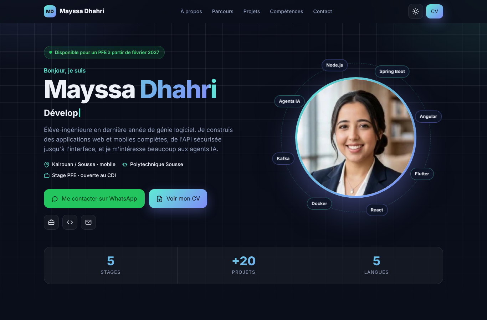

# 👩‍💻 Portfolio · Mayssa Dhahri

> Élève-ingénieure en génie logiciel · Full-Stack · Mobile · Agents IA
> **Recherche un stage de fin d'études (PFE) à partir de février 2027**

🔗 **En ligne : https://mayssadhahri1.github.io/**



---

## ✨ Fonctionnalités

| Fonctionnalité | Description |
|---|---|
| **Projets GitHub en direct** | Les dépôts publics sont chargés depuis l'API GitHub : un nouveau dépôt apparaît tout seul. Recherche, filtre par langage, badges « À la une » et « Nouveau », répartition des langages. |
| **Fiabilité** | Cache navigateur (30 min) + copie de secours `data/github-snapshot.json` régénérée chaque jour par GitHub Actions. |
| **Projets phares** | Les 6 projets les plus représentatifs du CV. |
| **Contact direct** | WhatsApp (application sur téléphone, WhatsApp Web sur ordinateur) avec message pré-rempli, email, LinkedIn, GitHub, CV design et CV ATS. |
| **Animations soignées** | Entrée de l'accueil en cascade, technologies en orbite autour de la photo, compteurs animés, cartes inclinées en 3D au survol, lumière qui suit la souris. Désactivées si l'utilisateur préfère moins d'animations. |
| **Thème clair / sombre** | Choix mémorisé dans le navigateur. |
| **Responsive & accessible** | Pensé d'abord pour le téléphone, navigation au clavier, balises SEO et aperçu de lien. |
| **CI/CD** | Tests automatiques puis déploiement sur GitHub Pages à chaque `git push`. |

**Structure de la page :** Accueil → Ce que j'apporte → Parcours (stages, formation, certifications, langues) → Projets → Compétences → Contact.

## 🧱 Architecture

Le contenu est **séparé** de la présentation : toutes les informations sont dans un seul fichier, `data/profile.js`. Le site, le QR code et le badge lisent tous ce même fichier.

```
mayssa-portfolio/
├── index.html                 # Structure de la page
├── css/style.css              # Design (thèmes, responsive, animations)
├── js/main.js                 # Logique : rendu, onglets, thème, animations
├── js/github.js               # Projets GitHub en direct (API + cache + secours)
├── data/profile.js            # ⭐ Toutes les données (seul fichier à modifier)
├── assets/
│   ├── img/                   # Photo
│   ├── docs/                  # CV (design + ATS)
│   └── qr-code.svg / .png     # QR code du badge (scripts/generate_qr.py)
├── scripts/
│   ├── profile_loader.py      # Lit data/profile.js depuis Python
│   ├── fetch_github.py        # Copie de secours des dépôts (utilisé par la CI)
│   └── generate_qr.py         # Génère le QR code
├── tests/test_site.py         # 20 tests automatiques
├── badge/badge.html           # Badge imprimable (+ PDF et PNG)
├── .github/workflows/deploy.yml  # CI/CD : tests puis déploiement
└── requirements.txt
```

**Technologies :** HTML5, CSS3 (variables, Grid, Flexbox), JavaScript ES6 sans framework, Python 3 (segno, Pillow, unittest), GitHub Actions, GitHub Pages.

## 🚀 Lancer le projet en local

```bash
# 1. Récupérer le projet
git clone https://github.com/mayssadhahri1/mayssadhahri1.github.io.git
cd mayssadhahri1.github.io

# 2. Lancer un petit serveur web
python -m http.server 8000

# 3. Ouvrir http://localhost:8000 dans le navigateur
```

## 🔳 Générer le QR code (pour le badge imprimé)

```bash
pip install -r requirements.txt
python scripts/generate_qr.py      # → assets/qr-code.svg et assets/qr-code.png
```

Le lien du QR code est lu dans `data/profile.js` (`site.url`).

## ✅ Lancer les tests

```bash
pip install opencv-python-headless   # facultatif : pour vérifier que le QR code se lit bien
python -m unittest discover -s tests -v
```

Les tests vérifient les données, les liens (aucun fichier manquant), les formats (WhatsApp, email, https), les icônes, le QR code du badge et la structure de la page.

## 🐙 Afficher un nouveau projet GitHub

Rien à coder : crée le dépôt en **Public** sur GitHub, et il apparaît sur le site.
Pour une belle carte, remplis sur la page du dépôt (⚙️ à côté de « About ») :
- **Description** : une phrase claire ;
- **Website** : le lien de démo (un bouton « Démo » apparaît) ;
- **Topics** : les technos (`spring-boot`, `angular`…) et `portfolio` pour le mettre **À la une**.

Pour cacher un dépôt : ajoute son nom dans `github.exclude` (fichier `data/profile.js`).

## ✏️ Mettre à jour le contenu

1. Modifier `data/profile.js` (un projet, un stage, une compétence…).
2. Si le lien du site change : relancer `python scripts/generate_qr.py`.
3. `git add . && git commit -m "Mise à jour" && git push` : les tests et la mise en ligne se font tout seuls.

## 📬 Contact

- WhatsApp : [+216 55 954 339](https://wa.me/21655954339)
- Email : maissa.dhahri_1@polytechnicien.tn
- LinkedIn : [linkedin.com/in/mayssa-dhahri](https://www.linkedin.com/in/mayssa-dhahri/)

---
© 2026 Mayssa Dhahri
